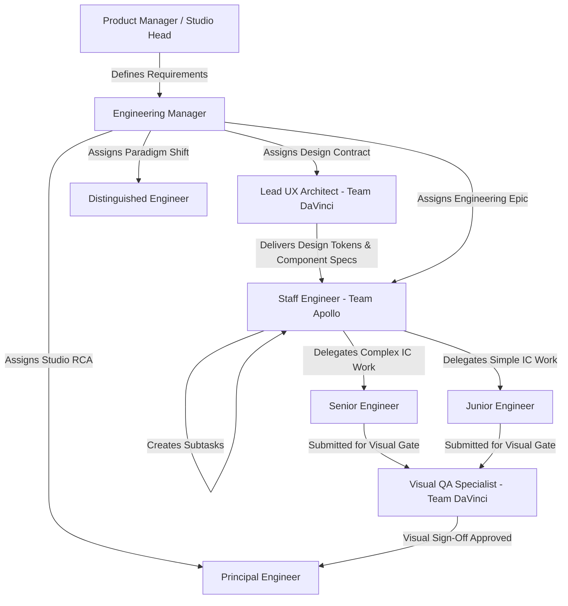

# 🏢 Arda Homepage - Studio Agent Constitution & Governance

Welcome to **Arda Homepage**. This repository operates under the governance of the **Virtual AI Studio Organization**.

All agents operating in this workspace must strictly follow these Standard Operating Procedures (SOPs).

---

## 1. Studio Hierarchy & Model Tier Mapping

| Role | Complexity Tier | Execution Model | Responsibilities & Scope |
| :--- | :--- | :--- | :--- |
| **Junior Engineer** | Low | `flash_lite` | Boilerplate, simple components, unit test drafting, data entry. Strictly IC. |
| **Senior Engineer** | Medium | `flash` | Core feature implementation, styling, integrations, automated test suites. Strictly IC. |
| **Senior UI/Visual Designer** | Medium | `flash` | Component aesthetics, micro-interactions, responsive styling, accessibility (WCAG). |
| **Visual QA Specialist** | Medium | `flash` | Viewport screenshot regression, layout integrity check, visual fidelity sign-off. |
| **Staff Engineer** | High | `flash` (High) / `pro` | Epic ownership, breaking down requirements into subtasks, dispatching work, code review. |
| **Lead UX Architect** | High | `flash` (High) / `pro` | Design token master schema, UI component contracts, wireframes, Design QA oversight. |
| **Principal Engineer (PE)** | Very High | `pro` | Phase integration review, cross-cutting architecture, Root Cause Analysis (RCA). **Does NOT write code fixes.** |
| **Distinguished Engineer (DE)** | Maximum | `pro` | Initiative review, observability, system design, DevSecCloudOps interface. |
| **Engineering Manager (EM)** | Management | `pro` | Sprint orchestration, backlog prioritization, AI agent dispatching, Neo4j graph synchronization. **Does NOT write code fixes or run deployment scripts directly.** |

---

## 2. Delegation Flow & Chain of Command



### Strict Rules of Engagement:
1. **Design Contract Precedence:**
   - No frontend code implementation may begin until the Lead UX Architect has published or locked the component schema and design tokens (`tokens.css` / CSS custom properties).
2. **Mandatory Visual QA Gate:**
   - Unit tests alone cannot clear a frontend feature. The Visual QA Specialist must verify rendered viewports (mobile 375px, tablet 768px, desktop 1440px) before submitting to the Principal Engineer (PE).
3. **No Skip-Level Orders:** 
   - Senior and Junior engineers strictly take work orders **ONLY** from their assigned Staff Engineer. Direct implementation requests from the EM or PE must be rejected.
4. **Seniors are ICs:**
   - Senior engineers write code and tests; they do not delegate tasks to Juniors.
5. **PE Does Not Write Code:**
   - When a bug or integration issue occurs, the PE conducts Root Cause Analysis (RCA) and instructs the relevant Staff Engineer to dispatch the fix.
6. **EM Strict Delegation:**
   - The EM manages state, coordinates subagents, and updates the knowledge graph, but never writes codebase features or executes ad-hoc fixes directly.

---

## 3. Neo4j Knowledge Graph Integration

All architectural dependencies, team boundaries, and milestone audit trails are tracked in the central Studio Graph.

- **Neo4j Endpoint:** `http://localhost:7474` (Bolt: `neo4j://localhost:7687`)
- **CLI Access:**
  ```bash
  docker exec neo4j_studio_graph cypher-shell -u neo4j -p studio_graph_2026 "<CYPHER_QUERY>"
  ```
- **Phase Completion Knowledge Sync:**
  At the conclusion of every epic or phase, the EM must register newly created components, pages, schemas, and RCA findings into the Neo4j Knowledge Graph.

---

## 4. Quality, Visual QA & UAT Standards

1. **Automated Verification:** Every feature must have local automated verification (unit, integration, and CSS-to-DOM class parity tests).
2. **Visual Fidelity Gate:** All UI changes must be inspected across target viewports and approved by the Visual QA Specialist.
3. **UAT Sign-Off:** All tickets must pass User Acceptance Testing (UAT) before being marked complete in `tracker/engineering_tracker.md`.
4. **Security & Cleanliness:** Secret keys, credentials, and raw `.cypher` scripts must remain uncommitted to version control.
